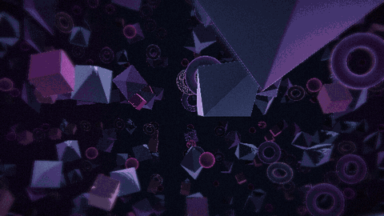

# NEON DRIFT

Eine audio-reaktive WebGL-Demoscene-Demo im Neon-Cyberpunk-Stil. Reines
HTML/CSS/JS + GLSL — kein Build-Step, keine Dependencies.



## Starten

```sh
python3 -m http.server 8080
# dann http://localhost:8080 im Browser öffnen, "Click to start" drücken
```

Beim Start läuft der eingebackene Track (`assets/track.ogg`). Du kannst
jederzeit **ein eigenes WAV/MP3 ins Browserfenster ziehen**, um es zu
ersetzen — die ganze Demo reagiert in Echtzeit darauf. (Fällt der Default-
Track aus, springt ein synthetisierter Beat als Fallback ein.)

Der mitgelieferte Track wurde mit [Suno](https://suno.com) erzeugt.

## Die Demo

Eine Reise durch 14 Welten (loopt endlos, 228s):

1. **Intro** (0–10s) — Sterne, Titel glüht rein
2. **Nebula Flight** (10–24s) — Vorwärts-Flug durch driftende Nebula, erste Gel-Bubbles
3. **Gel Bubbles** (24–38s) — wenige klare Glas-Gel-Bubbles, langsam wabernd
4. **Figure Flight** (38–58s) — Durchflug durch ein Feld glühender Neon-Figuren, Banking-Kamera
5. **City Flyover** (58–76s) — Flug durch eine Neon-Stadt mit beleuchteten Fenstern
6. **Wormhole** (76–92s) — verdrehter, rotierender Tunnel mit gleißendem Kern
7. **Tentacle Field** (92–110s) — Durchflug durch wabernde Neon-Säulen
8. **Outrun Floor** (110–126s) — Synthwave-Gitterboden + Neon-Sonne
9. **Neon Tunnel** (126–142s) — Flug durch eine Neon-Gitter-Röhre
10. **Wireframe** (142–158s) — rotierendes Neon-Drahtgitter-Vektorobjekt
11. **Mega Structure** (158–178s) — Gitterkugel mit Panels, 3 Ringen, umlaufenden Monden
12. **Mandelbox** (178–196s) — fraktaler Tempel
13. **Kaleidoscope** (196–210s) — gespiegelte Mandala-Psychedelik
14. **Laser Finale** (210–228s) — Laser-Salven, Regenbogen-Greetings-Scroller

Audio: Bass pumpt die Bubbles, Höhen triggern Laser, Beat treibt Glow &
Chromatic Aberration, **Drops** (Spectral-Flux-Erkennung) lösen Flashes aus.
Die ganze Pipeline läuft mit **Motion-Blur-Trails**.

Dev: `?scene=NAME` isoliert eine Szene (z.B. `?autostart&scene=worm`).

## Steuerung

| Taste | Funktion |
|-------|----------|
| `F` | Vollbild an/aus |
| `← / →` | 10s in der Timeline zurück/vor springen |
| `H` | UI/Overlays aus- und einblenden |
| `+ / -` | Render-Auflösung hoch/runter (Performance) |
| Maus | leichtes Parallax-Tilt der Kamera |

Die Auflösung skaliert zudem **automatisch**, um ~55fps zu halten.

## Dev-/Kiosk-Parameter

- `?autostart` — überspringt das Klick-Overlay (z.B. für Kiosk-Mode)
- `?t=SECONDS` — springt direkt an die Stelle der Timeline (zum Testen)

z.B. `http://localhost:8080/?autostart&t=50`

## Aufbau

| Datei | Aufgabe |
|-------|---------|
| `index.html` | Canvas, Overlays (Titel/Scroller), Start-Screen |
| `js/main.js` | Wiring, Render-Loop, Drag&Drop |
| `js/gl.js` | WebGL2-Renderer (Szene → Framebuffer → Post-Pass) |
| `js/audio.js` | Web-Audio: FFT-Analyse, Platzhalter-Beat, File-Loader |
| `js/director.js` | Timeline → Part-Gewichte + Overlay-Zustand |
| `js/shaders.js` | GLSL: Raymarcher + Post-Processing |

Design-Doc: `docs/superpowers/specs/2026-05-26-neon-drift-demo-design.md`
